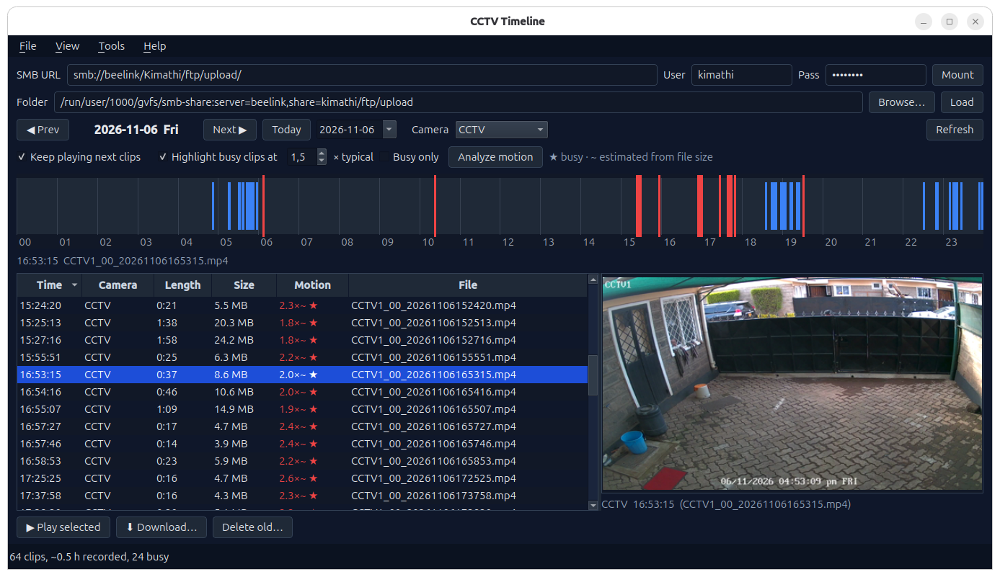

# CCTV Timeline



A fast, dark-themed desktop viewer for Reolink-style FTP camera recordings. Browse each day on a 24-hour timeline, preview frames on hover, spot busy clips at a glance, play footage in mpv, download clips locally, and clean up old recordings — all without opening a browser or manually digging through `YYYY/MM/DD` folders.


---

## Features

- **Day timeline per camera** — click anywhere on the 24-hour bar to play from that moment in mpv.
- **Hover previews** — frame thumbnails extracted with ffmpeg as you move across the timeline.
- **Busy-clip detection** — clips are highlighted in red, either estimated instantly from file size or analyzed accurately with ffmpeg scene scores.
- **Per-camera normalization** — a "busy" clip is judged against that camera's typical clip, so quiet and active cameras are both handled fairly.
- **Right-click anywhere** — play, download, open the folder, copy the path, analyze motion, or delete a clip from either the list or the timeline.
- **Multi-select downloads** — copy any number of clips to a local folder with progress and cancellation. Interrupted copies are written as `.part` and never look like real recordings.
- **SMB support** — mount a share via `gio` straight from the app.
- **Cleanup tool** — delete recordings older than N days, with a scan-and-confirm step so nothing goes missing by accident.
- **Frameless About/Delete dialogs** with system-native dragging and snapping.

---

## Requirements

| Component | Purpose | Install (Ubuntu/Debian) |
|---|---|---|
| Python 3.10+ | Runtime | — |
| PySide6 | GUI | `pip install PySide6` |
| **ffmpeg** | Thumbnails & motion analysis | `sudo apt install ffmpeg` |
| **mpv** | Video playback | `sudo apt install mpv` |
| **gio / gvfs** | SMB mounting (optional) | `sudo apt install libglib2.0-bin gvfs-backends` |

ffmpeg and mpv are found on `PATH`. The app still runs without them — you just lose previews, analysis, and playback.

---

## Installation

```bash
git clone https://github.com/<your-user>/cctv-timeline.git
cd cctv-timeline
python3 -m venv .venv
source .venv/bin/activate
pip install PySide6
```

Then run it:

```bash
python3 cctv_viewer.py
```

The first line of `cctv_viewer.py` (`#!.venv/bin/python3`) lets you run it directly as `./cctv_viewer.py` if you keep the virtualenv in `.venv`.

### Build a standalone app

```bash
pip install pyinstaller
pyinstaller --noconfirm --windowed --name cctv_viewer \
    --icon assets/cctv.ico --add-data "assets:assets" cctv_viewer.py
```

The result is a one-folder app in `dist/cctv_viewer/`. The icon ends up at `_internal/assets/cctv.ico`, which is where `cctv_core.resource_path` looks for it.

---

## Expected folder layout

Each subfolder of the root is treated as a camera. Inside it, recordings live under `YYYY/MM/DD/`:

```
<root>/
└── CCTV/
    ├── 2026/
    │   └── 10/
    │       ├── 20/
    │       │   └── CCTV1_00_20261020000349.mp4
    │       └── 21/
    │           ├── CCTV1_00_20261021000349.mp4
    │           └── CCTV1_00_20261021000549.mp4
    └── 2026/...
```

**Filename format:** `<camera>_<channel>_<YYYYMMDDHHMMSS>.mp4`, e.g. `CCTV1_00_20261021000349.mp4`.

**Duration inference:** the file's modification time is assumed to be when the FTP upload finished (i.e. the end of the clip), so `duration ≈ mtime − start time`. This is why copies preserve original timestamps.

---

## Quick start

1. Launch the app.
2. **Folder:** point it at the root containing your camera subfolders, or enter an `smb://server/share` URL and click **Mount**.
3. The timeline populates with today's recordings. Use the date picker or **Alt+Left / Alt+Right** to change days.
4. **Click** the timeline to play from that moment. **Hover** to see a frame preview.
5. Press **Ctrl+Shift+M** to run motion analysis and get accurate busy-clip highlighting.
6. Use **Tools → Delete old recordings…** periodically to keep the share from filling up.

---

## Keyboard shortcuts

| Shortcut | Action |
|---|---|
| `Ctrl+O` | Open folder |
| `Ctrl+M` | Mount SMB share |
| `F5` | Reload |
| `Ctrl+S` | Download selected clips |
| `Ctrl+Q` | Exit |
| `Alt+Left` / `Alt+Right` | Previous / next day |
| `Ctrl+T` | Jump to today |
| `Ctrl+Shift+M` | Analyze motion |
| `Ctrl+D` | Delete old recordings |
| `F1` | About |

---

## How busy-clip detection works

There are two modes, shown with a small marker in the Motion column:

- **`~` (estimated, instant)** — when a clip is loaded, its bytes-per-second rate is compared to the median for that camera. Static scenes compress well; active scenes don't. This gives an immediate, zero-cost estimate.
- **accurate (after analysis)** — pressing **Analyze motion** asks ffmpeg to extract scene-change scores from **keyframes only** (`-skip_frame nokey`), which is far cheaper than decoding every frame. The busiest quarter of scores is averaged per clip and again normalized against the camera's median. A clip is flagged busy if its score is at least `factor ×` the camera's typical score (default `1.5×`) **and** the raw score exceeds a small floor (`MIN_SCENE = 0.02`), so near-static clips are never labeled busy.

Results are cached in `motion.json` keyed by path + size + mtime, and are reused automatically unless the file changes.

**Tip:** run analysis once per day shortly after the recordings land — it's a couple of seconds per clip and survives restarts.

---

## Where data is stored

| Path | Contents |
|---|---|
| `~/.config/cctv_viewer.json` | Settings (root folder, SMB URL, window geometry, last download dir, cleanup preference) |
| `~/.cache/cctv_viewer/thumbs/` | Cached thumbnail PNGs (auto-pruned after 14 days) |
| `~/.cache/cctv_viewer/motion.json` | Cached motion analysis results |

Use **Tools → Clear thumbnail cache** to wipe the thumbnails manually.

---

## Notes & limitations

- **Deletion is permanent.** Files deleted via the cleanup tool or clip context menu are removed with `os.remove` — there is no trash folder, including on SMB shares. The confirmation dialogs are there for a reason.
- **mtime-based duration** can be wrong if the camera's clock and the FTP server's clock disagree, or if files are moved in ways that alter mtime. A wrong duration mostly affects timeline block width; playback still starts at the correct moment because the real timestamp comes from the filename.
- **Busy detection is a heuristic.** Scene scores register motion, not objects — a tree moving in the wind counts, a person standing still might not.
- **mpv is required for playback.** The app will tell you if it can't find it.

---

## Project layout

```
cctv_core.py     GUI-independent logic: config, SMB, scanning, ffmpeg, cache, copy, cleanup
cctv_viewer.py   PySide6 interface: timeline widget, table, dialogs, background jobs
assets/          App icon (cctv.ico)
```

`cctv_core.py` imports no GUI libraries, so it can be tested and scripted headlessly. The GUI keeps all long-running work off the main thread via a small dispatcher that hands results back through Qt signals.

---

## License

MIT — see [LICENSE](LICENSE).
